  

# 🔔 Awesome Desktop Notifications & Team Collaboration

  
  
  
  
  
  

  <strong>Curated Directory of Open-Source Projects, Self-Hosted Daemons &amp; SaaS Notification Infrastructure</strong> 
  <em>Push Notifications &bull; Desktop Alert Daemons &bull; Webhook Event Pipelines &bull; Multi-Channel Alert Routers &bull; In-App Notification Hubs</em>

---

## 📌 Overview & SEO Summary

Welcome to the definitive, SEO-optimized awesome list tracking the **Desktop Notifications & Team Collaboration Ecosystem**. Whether you are building real-time developer monitoring alerts, integrating cross-platform desktop toast notifications, hosting private push servers, or orchestrating high-volume multi-channel incident dispatches across Slack, Discord, SMS, and WebPush, this repository curates the industry's premier tools.

### 🎯 Key Highlights:
- 🚀 **Self-Hosted & Privacy-Preserving Push Services**: `ntfy`, `Gotify`, and `Apprise` for zero-tracking alerting pipelines.
- 💻 **Desktop Toast Daemons & Notification Systems**: `Dunst`, `Mako`, `SwayNC`, and `beeep` for native Linux, macOS, and Windows toast integration.
- ⚡ **Multi-Channel Notification Infrastructure**: `Novu`, `Knock`, and `Courier` for centralizing in-app inboxes, email, push, and team chat.
- 💬 **Team Collaboration & Chat Alert Hubs**: `Rocket.Chat`, `Mattermost`, `Zulip`, `Slack`, and `Discord` for interactive team bot webhooks.
- 📱 **Device Sync & Mirroring**: `KDE Connect` and `Pushbullet` for bridging mobile SMS and app notifications to developer desktops.

---

## 📑 Table of Contents

- [📊 Sector Overview & Market Dynamics](#-sector-overview--market-dynamics)
- [🏢 SaaS/Hosted Platforms](#-saashosted-platforms)
- [⭐ Open-Source GitHub Projects](#-open-source-github-projects)
  - [Top Open-Source Repositories (Ranked by Stars)](#-top-open-source-repositories-ranked-by-stars)
  - [Architectural Patterns & Custom Systems](#-architectural-patterns--custom-systems)
- [📈 Star History](#-star-history)
- [🤝 How to Contribute](#-how-to-contribute)
- [💖 Support & Share](#-support--share)
- [⚠️ Disclaimer](#-disclaimer)

---

## 📊 Sector Overview & Market Dynamics

The notification infrastructure and team messaging alert sector is estimated at approximately **$4 billion to $15 billion globally**, expanding at an estimated **16%–26% CAGR**. 

- **Concentrated Foundation (Duopoly)**: The underlying device-delivery ecosystem remains heavily concentrated under an Apple (APNs) and Google (FCM) duopoly at the operating system level, alongside mega-cap enterprise team chat platforms (Slack/Salesforce, Microsoft Teams).
- **Fragmented Developer Infrastructure**: The multi-channel developer infrastructure, alert dispatch, and notification orchestration market is moderately fragmented. Fierce competition exists across API-first orchestration platforms, open-source self-hosted daemons, and unified routing gateways as engineering teams seek independence from proprietary vendor lock-in.

---

## 🏢 SaaS/Hosted Platforms

The following SaaS and hosted notification platforms provide managed infrastructure, high deliverability rates, and cross-channel orchestration. Entries are sorted in **descending order by company size, valuation, or annual revenue**.

| Company / Product | Size (Valuation / Revenue) | Starting Tier Pricing | Free Tier Limits | Description |
| :--- | :--- | :--- | :--- | :--- |
| **[Slack Notifications & Incoming Webhooks](https://slack.com)** | **$27.7B valuation** (Acquired by Salesforce; ~$3B+ ARR) | $8.75/user/month ($7.25/user/month billed annually) | 90-day message & file history, max 10 app integrations, 1:1 huddles | Ubiquitous team collaboration alert pipeline allowing automated bots, monitoring tools, and CI/CD workflows to post interactive Block Kit notifications to team channels. |
| **[Twilio Notify / Twilio Messaging & Push APIs](https://twilio.com)** | **$26B–$31B market cap** (~$5.83B TTM revenue) | Pay-as-you-go starting at $0.0083/message segment (US SMS) | 30-day free trial with 100 SMS messages (to verified numbers only) and $15.50 trial credit | Cloud communications API suite orchestrating multi-channel alerts across SMS, WhatsApp, Firebase/APNs mobile push, and voice webhooks. |
| **[Discord Webhooks](https://discord.com)** | **$7B–$10B valuation** (~$950M ARR) | $2.99/month (Nitro Basic) or $9.99/month (Nitro standard) | Free forever: 2,000 chars/message, up to 10 embeds, 30 requests/min rate limit per channel, 10 MB file uploads | Zero-config HTTP webhook endpoints for streaming structured embed alerts, build statuses, and community notifications directly into Discord channels. |
| **[OneSignal](https://onesignal.com)** | **$84.2M funding** (~$21M–$25M ARR) | $19/month (Growth Plan) | 1,000 Mobile Push MAUs, 10,000 web push subscribers, 10,000 emails/month, 3 active Journeys | High-volume customer engagement and push notification platform supporting web push, mobile push, in-app messaging, and automated audience segmentation. |
| **[Courier](https://courier.com)** | **$57M funding** (Series B) | $0.005/send (Business Plan pay-as-you-go over free tier) | 10,000 sends/month free forever (1 send = 1 notification template across any channels) | Cloud notification API and visual workflow designer unifying push notifications, Slack/Teams messages, SMS, and transactional email with delivery routing rules. |
| **[Knock](https://knock.app)** | **$18M funding** (Series A) | $250/month (Starter Plan) | 10,000 messages/month, 500 guide recipients/month, 500 agent credits/month | Developer-first notification infrastructure platform offering cross-channel routing, smart batching/digests, observability logs, and drop-in React/mobile feed components. |
| **[Novu Cloud](https://novu.co)** | **$6.6M funding** (Seed) | $30/month (Pro Plan) | 10,000 workflow runs/month, 5 workflows, 2 environments, 3 team members, 24-hr activity retention | Managed cloud edition of Novu providing an embeddable `<Inbox />` component, multi-channel workflow orchestration (push, email, SMS, chat), and user preference centers. |
| **[MagicBell](https://magicbell.com)** | **$20M valuation** ($4.7M funding, ~$1.2M ARR) | $249/month (Startup Plan) | 1,000 deliveries/month, 1 project, unlimited users & team members | Embeddable notification inbox and real-time push infrastructure featuring multi-device read-state synchronization, smart delivery preferences, and WebSocket updates. |
| **[Pushbullet](https://pushbullet.com)** | **$1.62M funding** (Seed / Bootstrapped) | $4.99/month or $39.99/year ($3.33/month) (Pro Plan) | 100 SMS messages/month, 500 pushes/month, 25 MB max file size, 2 GB total cloud storage | Cross-device notification mirroring and quick-link/file-pushing service bridging Android notifications, SMS replies, and desktop browsers. |
| **[Pushover](https://pushover.net)** | **Bootstrapped / Profitable Micro-SaaS** (Pushover LLC) | $4.99 one-time purchase per platform (iOS, Android, Desktop) | 30-day free trial on apps; developer token allows up to 10,000 messages/month | Simple, reliable cross-platform push notification service delivering real-time alerts to iOS, Android, and desktop browsers via a straightforward HTTP REST API and email gateway. |

---

## ⭐ Open-Source GitHub Projects

Explore the finest self-hosted, privacy-first, and open-source notification projects. All repositories below are **sorted in descending order by GitHub_Stars_Count**, featuring a real-time Stars_Badge linking directly to each repository's stargazers page.

### 🌟 Top Open-Source Repositories (Ranked by Stars)

1. **[n8n](https://github.com/n8n-io/n8n)**   
   ⚡ Fair-code workflow automation platform with 400+ native integrations connecting webhooks, incident alerts, CI/CD statuses, and team chat channels with visual logic.

2. **[Uptime Kuma](https://github.com/louislam/uptime-kuma)**   
   📈 Self-hosted monitoring tool featuring an intuitive UI, fast ping/HTTP/certificate checks, and built-in dispatch to 90+ notification services (Telegram, Discord, Slack, ntfy, Gotify, Apprise).

3. **[Rocket.Chat](https://github.com/RocketChat/Rocket.Chat)**   
   🚀 Comprehensive open-source communications hub and team collaboration platform featuring omni-channel messaging, desktop notifications, VoIP, and enterprise-grade webhook integrations.

4. **[Novu](https://github.com/novuhq/novu)**   
   📬 Open-source developer notification infrastructure offering a unified API, visual workflow builder, digest engine, user preference center, and embeddable React/Vue in-app notification center.

5. **[Mattermost](https://github.com/mattermost/mattermost)**   
   💬 Open-source, self-hosted Slack alternative engineered for technical and security-conscious teams, with granular webhook payloads, slash commands, and desktop/mobile push relays.

6. **[ntfy](https://github.com/binwiederhier/ntfy)**   
   🔔 Simple, blazing-fast HTTP-based pub-sub notification service written in Go. Send desktop alerts or mobile push notifications via simple `curl` `PUT`/`POST` requests without sign-ups.

7. **[Zulip](https://github.com/zulip/zulip)**   
   🧵 Organized team chat application that blends real-time conversation with email-style threading, complete with robust incoming webhook integrations and native desktop alerts.

8. **[Apprise](https://github.com/caronc/apprise)**   
   🌐 Python library and microservice gateway providing a unified notification dispatch syntax across 100+ services including Discord, Telegram, Slack, ntfy, Gotify, and native desktop notifications.

9. **[Gotify](https://github.com/gotify/server)**   
   🛡️ Self-hosted WebSocket push notification server written in Go with a sleek web UI, CLI client, and Android/desktop push delivery capabilities.

10. **[Prometheus Alertmanager](https://github.com/prometheus/alertmanager)**   
    🚨 Production-grade alert handling engine that deduplicates, groups, silences, and routes monitoring metrics from Prometheus to Opsgenie, PagerDuty, Slack, email, or custom webhooks.

11. **[Louis-CFM/coucou](https://github.com/Louis-CFM/coucou)**   
    👋 Minimalist desktop notification and peer team ping tool crafted for fast, lightweight team collaboration and instantaneous desktop awareness.

12. **[node-notifier](https://github.com/mikaelbr/node-notifier)**   
    🖥️ Flexible Node.js module to send native cross-platform desktop notifications on macOS (Notification Center), Windows (Toast / balloon), and Linux (notify-send).

13. **[Dunst](https://github.com/dunst-project/dunst)**   
    🐧 Highly customizable, lightweight notification daemon for X11 and Wayland environments supporting custom action rules, keyboard shortcuts, and script triggers.

14. **[KDE Connect](https://github.com/KDE/kdeconnect-kde)**   
    📲 Seamless multi-device integration utility syncing phone notifications, SMS replies, media controls, and shared clipboard securely to desktop operating systems over local Wi-Fi.

15. **[web-push](https://github.com/web-push-libs/web-push)**   
    🌐 Foundational VAPID Web Push protocol implementation for sending push notifications directly to browser runtimes without reliance on proprietary third-party proxies.

16. **[Mako](https://github.com/emersion/mako)**   
    🪟 Lightweight Wayland-native notification daemon designed specifically for Sway, wlroots, and modern minimal Wayland compositors.

17. **[SwayNotificationCenter (SwayNC)](https://github.com/ErikReider/SwayNotificationCenter)**   
    🎛️ Feature-rich, GTK-powered notification center and desktop daemon for Wayland compositors with Do-Not-Disturb toggles, notification widgets, and customizable CSS styling.

18. **[Statping-ng](https://github.com/statping-ng/statping-ng)**   
    📊 Open-source status page and monitoring server that sends outage and health check notifications across Discord, Slack, email, and webhooks.

19. **[beeep](https://github.com/gen2brain/beeep)**   
    🔔 Pure Go cross-platform library for sending native desktop toast notifications and beeps across Windows, macOS, Linux, and FreeBSD.

20. **[Shoutrrr](https://github.com/containrrr/shoutrrr)**   
    📦 Golang notification library and CLI utility tailor-made for Docker containers and cloud infrastructure to dispatch alerts across Slack, Discord, Gotify, Pushover, and Teams.

21. **[notify-rust](https://github.com/hoodie/notify-rust)**   
    🦀 Fast, type-safe Rust library for sending native desktop notifications on Linux (via D-Bus), macOS, and Windows.

---

### 🧩 Architectural Patterns & Custom Systems

Need to build a resilient, tailored notification architecture? Here are proven open-source blueprints:
- **Zero-Cloud Incident Alerts**: Run `Uptime Kuma` + `ntfy` or `Gotify` for instantaneous push alerts to developer phones and desktop workstations without third-party brokers.
- **Universal Multi-Channel Bot**: Couple `Apprise` or `Shoutrrr` with CI/CD runners to simultaneously push commit and deploy alerts to Slack channels, Discord webhooks, and desktop screens.
- **Embedded In-App Feeds**: Deploy `Novu` with Docker for full in-app inbox components, notification preference management, and subscriber routing.
- **Minimalist Linux Workstations**: Pair `Dunst` or `SwayNC` with `notify-send` for snappy desktop notifications triggered by shell scripts and terminal watchers.

---

## 📈 Star History

---

## 🤝 How to Contribute

Contributions are warmly welcomed! Help keep this ecosystem comprehensive, accurate, and up-to-date:

1. 🍴 **Fork the repository**.
2. 🌿 **Create a new branch** (`git checkout -b feature/new-notification-tool`).
3. 📝 **Add or edit entries in `README.md`** (follow existing tabular or star-badge formatting).
4. 🔍 **Verify links, descriptions, and factual accuracy**.
5. 🚀 **Submit a Pull Request** with a concise description of the addition or revision.

---

## 💖 Support & Share

Thank you so much for exploring this curated guide! If this project helps streamline your notification pipelines, desktop workflows, or team alerting systems, please consider showing your support:

- ⭐ **Star this repository** to improve visibility and help other engineers discover these tools.
- 🍴 **Fork and share** the repo across your dev team, LinkedIn, X/Twitter, or Reddit.
- ☕ **Buy me a coffee & Sponsor**: If you'd like to back ongoing open-source curation and development, consider sponsoring via the [GitHub Sponsors Dashboard](https://github.com/sponsors/ishandutta2007) — every bit of support is deeply appreciated!

  

---

## ⚠️ Disclaimer

- This repository is a **community-driven curated directory** provided for educational and architectural reference purposes only. Inclusion does not imply official endorsement.
- **Security Best Practices**: Self-hosted notification gateways (`ntfy`, `Gotify`, `Novu`, etc.) exposed over public networks should always be guarded behind HTTPS/TLS termination, access tokens, and rate limits.
- **Confidentiality & Privacy**: Never transmit plaintext API credentials, secrets, or sensitive PII via push notification bodies, as intermediate mobile OS push relays (APNs/FCM) process message payloads during routing.

---

  Built with ❤️ for DevOps engineers, sysadmins, backend developers, remote teams, and open-source enthusiasts worldwide.

